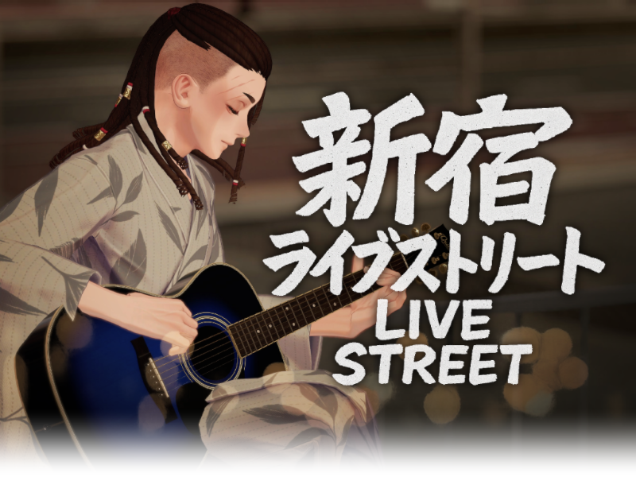
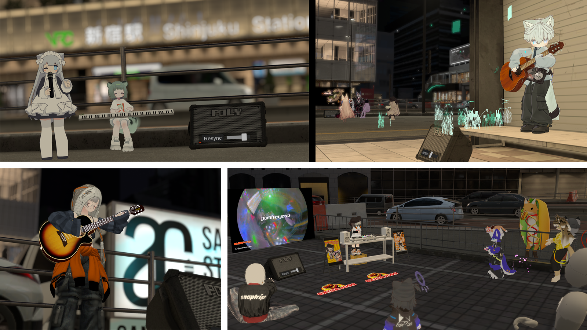
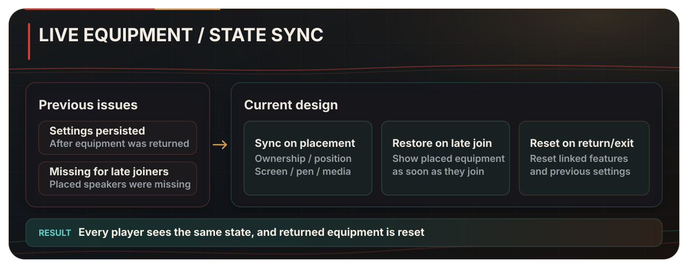
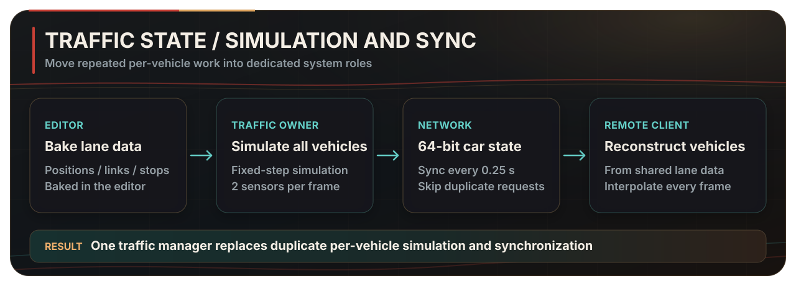
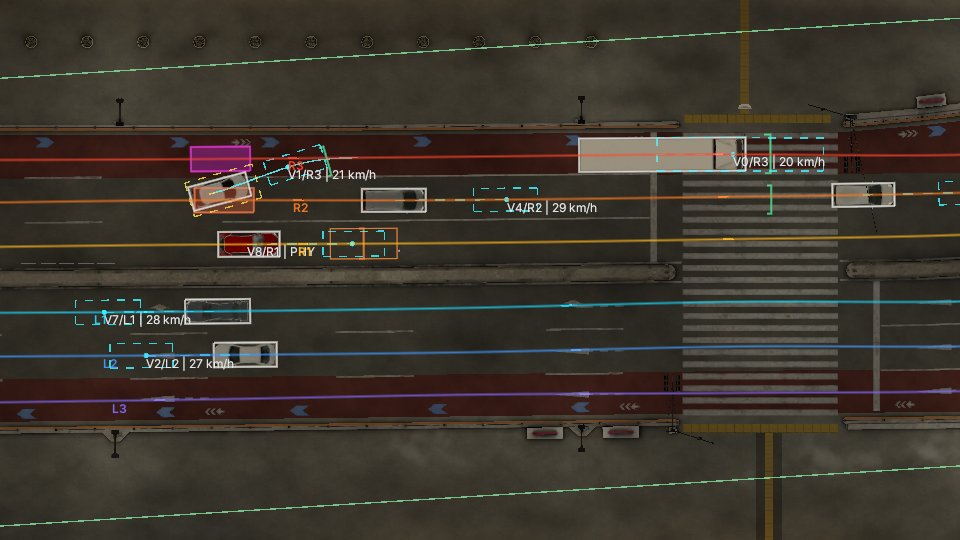
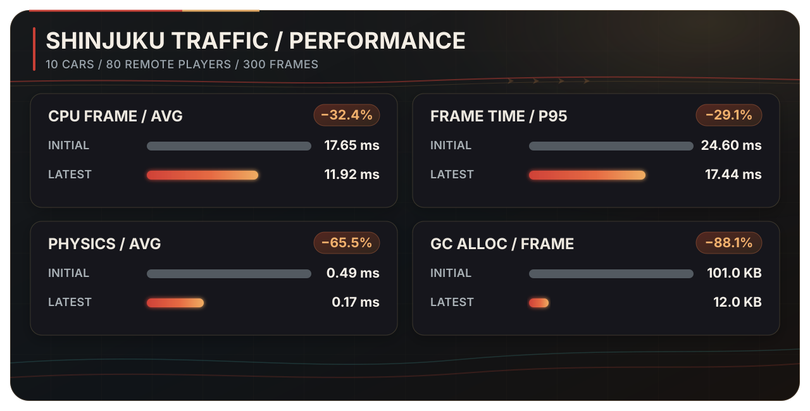
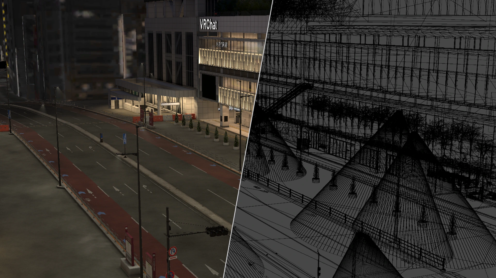

  <a href="./README.md">日本語</a> / <a href="./README.ko.md">한국어</a> / <strong>English</strong>

  
  <h1>Shinjuku Live Street</h1>

<strong>A runnable Unity project is not included. This repository presents selected code and key development work.</strong>

  <picture>
    <source media="(prefers-color-scheme: dark)" srcset="./Docs/images/world-intro.en.svg">
    
  </picture>

<table align="center">
  <tr>
    <td width="180" align="center"> <strong>1,929,340</strong> Total visits</td>
    <td width="180" align="center"> <strong>67,260</strong> Favorites</td>
    <td width="180" align="center"> <strong>Up to 80</strong> Capacity</td>
  </tr>
</table>

  <a href="https://vrchat.com/home/world/wrld_c82a5c14-97a5-4782-a034-d897d2d943a2/info"><strong>Open the world in VRChat ↗</strong></a>

VRChat social world / Unity / UdonSharp / Two-person team Visits and favorites as of October 12, 2026

## Street performances and community

  <picture>
    <source media="(prefers-color-scheme: dark)" srcset="./Docs/images/community-highlights.en.svg">
    
  </picture>

  <a href="https://x.com/search?q=%23VRSJK&src=typed_query&f=live"><strong>See performances and moments shared by visitors on #VRSJK ↗</strong></a>

  

https://github.com/user-attachments/assets/9ec884f0-df47-49f0-b39f-327cdfda0ede

Video provided by <a href="https://x.com/KixiVRC">@KixiVRC</a> / Photos provided by <a href="https://x.com/KixiVRC">@KixiVRC</a>, <a href="https://x.com/aoiaoitabi">@aoiaoitabi</a>, <a href="https://x.com/taque_0409">@taque_0409</a>, <a href="https://x.com/ponhayate_vrc">@ponhayate_vrc</a>, <a href="https://x.com/Samp1e_vd7">@Samp1e_vd7</a>

---

  
  

---

## Recent improvements

Checked October 12, 2026

The latest published code changes were merged on **September 21, 2026**. Updates improve speaker placement and returns, a map for finding performances, multilingual guidance, and individual settings.

| Merged | Main changes |
| --- | --- |
| September 21 | Improved speaker capacity checks and available counts. Return confirmation and retries fix blocked placement after returning a speaker, while stale return requests cannot affect a new placement. ([#16](https://github.com/hjcud/Shinjuku-Live-Street/pull/16)) |
| September 14 | The entrance map shows placed speakers, performer names, and usage counts. PC and VR placement cancellation, model selection, and placement guidance were also improved. ([#14](https://github.com/hjcud/Shinjuku-Live-Street/pull/14)) |
| September 14 | Added Japanese, Korean, and English guidance based on the VRChat language setting, plus individual vehicle visibility and ambient sound controls. Hiding vehicles keeps the shared traffic simulation running. |
| September 14 | Added editor tools for Quest scene separation, shader, lighting and sign checks, network ID repair, and SDK build verification. |
| September 12 | Restricted teleportation to a local event that runs only during an active teleport sequence. ([#11](https://github.com/hjcud/Shinjuku-Live-Street/pull/11)) |

### Finding performances and adjusting local settings

The map reuses synchronized speaker placement data to display positions and performer names. Speakers outside the map still count toward total usage, and name labels are repositioned to reduce overlap and stay within the map. Vehicle visibility and ambient sound controls share local settings that each player can adjust.

### Shared live equipment — reliable state from setup to return

Portable speakers sometimes kept their screen, pen, or media settings after being returned or after their user left. Players joining later could also miss speakers that had already been placed in the world.

  

All players now see the same equipment state, and returned equipment no longer keeps the previous user's settings.

### Traffic simulation — centralizing repeated per-vehicle work

Each vehicle previously calculated its destination, ran a `BoxCast`, updated its Transform, and triggered serialization every frame. CPU frame time, physics-simulation time, and GC allocation rose together as the number of vehicles and players increased.

  

The traffic owner simulates vehicles through a single manager and sends each vehicle's state as a 64-bit record. The current published code sets the target population to **6 vehicles** and the replenishment interval to **0.8 seconds**. Remote clients reconstruct the vehicles from the same lane data and interpolate their movement every frame to keep it smooth.

<strong>View the runtime debug screen</strong>

  
   
  Baked lanes, occupied areas, predicted positions, and obstacle-sensor ranges

### Performance results — existing 300-frame captures

These results are the comparison published in the September 3, 2026 README. Ten vehicles describes the historical test setup; the current code has not been remeasured for this update. Reductions are calculated from unrounded averages in the [published measurement data](./Docs/benchmarks/traffic-300-frames/README.md).

Results are a like-for-like comparison in Unity Editor with ClientSim; live VRChat instance performance may differ.

Ten vehicles and 80 remote players simulated with ClientSim were concentrated in the same area. We captured 300 frames from both the initial and improved snapshots in the Unity Editor. Average CPU frame time fell from `17.65 ms to 11.92 ms`, while P95 frame time fell from `24.60 ms to 17.44 ms`. Physics time fell by 65.5%, and GC allocation per frame by 88.1%.

  <a href="./Docs/optimization.en.md"><strong>View test conditions and implementation details →</strong></a>

---

## Model and rendering optimization

The model and rendering figures below come from the existing development record; they have not been recounted after subsequent PC and Quest scene changes.

  
   
  Left: normal render / Right: wireframe captured from the same camera

The environment is divided into sections, with occlusion culling, static batching, and baked lighting used to reduce real-time rendering work.

<table align="center">
  <tr>
    <td width="260" align="center"><strong>Model geometry</strong> 246,921 triangles 240 environment meshes 2 mesh colliders</td>
    <td width="260" align="center"><strong>Rendering</strong> 392 static-batched objects 330 occluders</td>
    <td width="260" align="center"><strong>Baked lighting</strong> Applied to approximately 220 meshes 3 × 4096×4096 lightmaps 1 × 512×512 lightmap</td>
  </tr>
</table>

## Code map

| Area | Key files | Responsibility |
| --- | --- | --- |
| Live equipment | [`SpeakerManager.cs`](./Assets/_Shinjuku/Scripts/Speaker/SpeakerManager.cs), [`SpeakerController.cs`](./Assets/_Shinjuku/Scripts/Speaker/SpeakerController.cs) | Speaker placement, validation, ownership, late-join sync, and reset |
| Stage voice | [`VoiceRange.cs`](./Assets/_Shinjuku/Scripts/Speaker/VoiceRange.cs) | Shared performer voice range and gain |
| Shared interactions | [`ObjectGlobalToggle.cs`](./Assets/_Shinjuku/Scripts/ObjectToggle/ObjectGlobalToggle.cs), [`ObjectLocalToggle.cs`](./Assets/_Shinjuku/Scripts/ObjectToggle/ObjectLocalToggle.cs) | Separation of global and local state |
| Traffic runtime | [`TrafficSimulationManager.cs`](./Assets/_Shinjuku/Scripts/Traffic/TrafficSimulationManager.cs) | Simulation, state packing, transfer, and remote reconstruction |
| Lane data | [`TrafficLaneDatabase.cs`](./Assets/_Shinjuku/Scripts/Traffic/TrafficLaneDatabase.cs) | Baked lane lookup and vehicle pose reconstruction |
| Editor tooling | [`TrafficLaneBakerEditor.cs`](./Assets/_Shinjuku/Editor/Traffic/TrafficLaneBakerEditor.cs), [`TrafficSimulationManagerEditor.cs`](./Assets/_Shinjuku/Editor/Traffic/TrafficSimulationManagerEditor.cs) | Lane baking, validation, and visualization |
| World utilities | [`PosterSlide.cs`](./Assets/_Shinjuku/Scripts/Posters/PosterSlide.cs), [`PortalToggle.cs`](./Assets/_Shinjuku/Scripts/Portal/PortalToggle.cs), [`CollisionTeleport.cs`](./Assets/_Shinjuku/Scripts/Teleport/CollisionTeleport.cs) | Poster transitions, portals, and teleportation |
| Performance map | [`SpeakerMap.cs`](./Assets/_Shinjuku/Scripts/UI/SpeakerMap.cs), [`SpeakerMapNameLayout.cs`](./Assets/_Shinjuku/Scripts/UI/SpeakerMapNameLayout.cs) | Speaker positions, performer names, usage counts, and name layout |
| Language and local settings | [`WorldLanguage.cs`](./Assets/_Shinjuku/Scripts/UI/WorldLanguage.cs), [`WorldLocalSettings.cs`](./Assets/_Shinjuku/Scripts/UI/WorldLocalSettings.cs), [`SpeakerMapPanel.cs`](./Assets/_Shinjuku/Scripts/UI/SpeakerMapPanel.cs) | Shared language selection, local vehicle visibility, ambient sound, and settings UI |
| Image loading | [`ImageLoader.cs`](./Assets/_Shinjuku/Scripts/Speaker/ImageLoader.cs) | URL image loading and reset for speaker screens |
| Map and guidance tools | [`SpeakerMapSetup.cs`](./Assets/_Shinjuku/Editor/SpeakerMapSetup.cs), [`SpeakerPlacementSetup.cs`](./Assets/_Shinjuku/Editor/SpeakerPlacementSetup.cs), [`LocalPatchBoardSetup.cs`](./Assets/_Shinjuku/Editor/LocalPatchBoardSetup.cs) | Map, placement guide, and multilingual update board setup |
| Quest tools | [`QuestSceneSplitSetup.cs`](./Assets/_Shinjuku/Editor/QuestSceneSplitSetup.cs), [`QuestSceneAudit.cs`](./Assets/_Shinjuku/Editor/QuestSceneAudit.cs), [`QuestSdkBuildVerification.cs`](./Assets/_Shinjuku/Editor/QuestSdkBuildVerification.cs) | Quest scene separation, audits, and SDK build verification |

## Repository scope

This repository is not a complete, runnable Unity project. It shares our C# and UdonSharp code, development documentation, and images and videos created by us or contributed by others to introduce the world. Unity scenes, prefabs, models, textures, audio, video, materials, animations, shaders, `.meta` files, and third-party assets required to run the world are not included.

The published code is a subset of the full project. For example, the `WorldPlayerData` persistence layer referenced by `WorldLocalSettings` is excluded from publication. Editor tools also depend on scene and asset paths in the original project, so cloning this repository alone is insufficient to compile it or build the world.

<strong>SDKs, packages, and third-party components</strong>

### Development environment

Installed versions checked against the Unity version and package configuration of the development project on October 12, 2026.

- Unity `2022.3.22f1`
- VRChat SDK - Worlds `3.10.5`
- UdonSharp
- TextMesh Pro `2.1.6`

### Third-party components used in the world

- Topaz Chat `0.3.0`
- lilToon `2.3.4`
- VRWorldToolkit `3.4.1`
- AVPro Video
- Bakery GPU Lightmapper
- QvPen
- IwaSync3 / HoshinoLabs
- Media Manager
- Mochie Shaders
- EasyTextures
- VRC Players Only Mirror
- VRC Music Event Calendar
- Year Progress Bar
- imagePad
- Lura's Switch (Udon)
- Prototype Collection
- AllSkyFree
- Noriben Lunch shader assets
- Models and environment resources from Atelier Rayrell, RIONESTA, Zelkova Tree, and other creators

Third-party components are not included in this repository. Their respective authors and distributors retain all rights and define their own license terms.

[View third-party license notices →](./Docs/THIRD_PARTY_NOTICES.md)

## Copyright and usage

> [!IMPORTANT]
> This repository is **source-available**, not open source. Reproducing, modifying, redistributing, or commercially using the code beyond viewing and forking it on GitHub requires prior written permission.

[Read the full copyright and usage terms](./COPYRIGHT.en.md) / [Request permission](https://github.com/hjcud/Shinjuku-Live-Street/issues/new?template=7-usage-permission-request.yml)

## Team

| Member | Role |
| --- | --- |
| [Artistoid](https://github.com/Artistoid) / [X @Artistoid_VRC](https://x.com/Artistoid_VRC) | Planning / Graphics / 3D modeling |
| [hjcud](https://github.com/hjcud) | Unity/UdonSharp systems and optimization |
